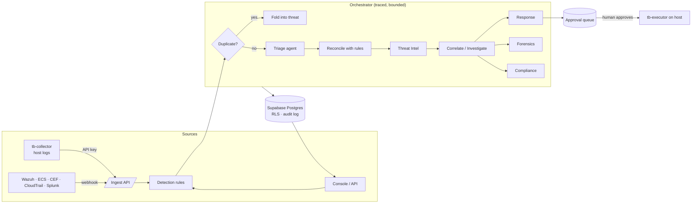

# 🛡️ ThreatBrain

**An agentic Security Operations Center: deterministic detection + specialist AI agents + human-approved response, with an evidence trail for every decision.**

ThreatBrain ingests security telemetry (host logs, SIEM alerts, cloud audit events), detects attacks with MITRE ATT&CK-mapped rules, lets specialist LLM agents triage, enrich, investigate and plan a response, and then **stops at a human**: nothing is executed on a host until an administrator approves it, and every step lands in an append-only audit trail.

> 🌐 Live demo: [threat-brain.vercel.app](https://threat-brain.vercel.app) · create a workspace at `/signup`, then click **Trigger pipeline** on the dashboard.

---

## What it does

| Capability | How it works |
|---|---|
| **Detection engine** | 37 Sigma-style YAML rules ([`backend/app/detection/rules.yaml`](backend/app/detection/rules.yaml)) mapped to ATT&CK tactics/techniques: brute force, password spraying, web exploitation, encoded PowerShell, reverse shells, credential dumping, ransomware indicators, log clearing, CloudTrail tampering, public buckets, … Runs without an LLM, so a model outage degrades the pipeline instead of stopping it. |
| **Alert de-duplication & correlation** | Repeat alerts fold into one threat (no tokens spent). New threats sharing an attacker IP join the open incident deterministically; the LLM only groups what is left. |
| **Agents** | Triage · Threat Intel · Investigation · Response · Forensics · Compliance · Hunt · **Log Analysis**. Each has a strict output schema, bounded retries, a timeout, a recorded run (tokens, latency, input, output) and receives the earlier agents' findings as shared context. |
| **Evidence-based verdicts** | Triage cites evidence; rule hits put a *floor* under severity (the model can't talk a known-bad pattern down); threat-intel reputation comes from the feeds, not the model; log-analysis findings are marked *verified* only if the cited line numbers exist. |
| **Threat intel** | AbuseIPDB, VirusTotal and AlienVault OTX (any subset), combined into a composite score. Private/internal addresses are never sent to third parties. |
| **Safe response** | The Response agent **recommends**; targets must appear in the incident's own evidence (a prompt-injected "block 8.8.8.8" is rejected), duplicates are suppressed, and actions queue for approval. `tb-executor` carries out *approved* actions on the host behind firewall/account guards. The server never executes anything itself. |
| **Case management** | Status lifecycle with timestamps, owner/priority, analyst notes, one chronological evidence timeline, Markdown report export, SOC metrics (detection latency, time to case/contain/resolve, noise suppressed, top techniques, agent health). |
| **Integrations** | Wazuh, Elastic ECS, CEF/syslog, AWS CloudTrail, Splunk and generic JSON webhooks; the `tb-collector` host agent; Discord alerts; scoped machine **API keys**. |
| **Governance** | Multi-tenant isolation, role-based access (viewer / analyst / admin / owner), rate limiting, security headers, audit log enforced append-only by a Postgres trigger. |

## Architecture



More detail (stage semantics, trust boundaries, data model): [docs/ARCHITECTURE.md](docs/ARCHITECTURE.md). What was found and fixed in the audit that produced this version: [docs/AUDIT.md](docs/AUDIT.md).

## Quick start

**Prerequisites:** Python 3.11+, Node 20+, a [Supabase](https://supabase.com) project (free tier is fine), and optionally a [Groq](https://console.groq.com) API key (without it the detection engine, de-dup and correlation still work; the LLM agents report "unavailable").

```bash
# 1. Database: run the files in database/migrations/ IN ORDER in the Supabase SQL editor.
#    Run 022 on its own (it adds an enum value; it cannot share a transaction with 023).
#    Optional demo data: database/seeders/001_demo_data.sql

# 2. Configuration
cp .env.example .env && cp .env.example backend/.env     # fill in Supabase + Groq values

# 3. Backend  -> http://localhost:8000/docs
cd backend && python -m venv venv && ./venv/bin/pip install -r requirements-dev.txt
./venv/bin/uvicorn app.main:app --reload --port 8000

# 4. Frontend -> http://localhost:5173   (reads frontend/.env.local)
cd frontend && npm ci && npm run dev
```

Or with Docker: `cp .env.example .env && docker compose up --build` (console on :5173, API on :8000).

`frontend/.env.local`:

```
VITE_API_BASE_URL=http://localhost:8000/api/v1
VITE_SUPABASE_URL=https://your-project-ref.supabase.co
VITE_SUPABASE_ANON_KEY=your_anon_key
```

### Connect real telemetry

1. In the console open **Settings → API keys** and create a key (`ingest` for collectors/SIEMs, `executor` for the response executor).
2. Host logs: `cd collector`, copy `collector.example.yaml` → `collector.yaml`, set `api_key` + `log_path`, run `python -m tb_collector --config collector.yaml` ([collector/README.md](collector/README.md)).
3. SIEM: `POST /api/v1/ingest/webhook/{wazuh|ecs|cef|cloudtrail|splunk|generic}` with `X-API-Key`.
4. Response: run `tb_executor` (starts in **dry-run**) and approve actions under **Approvals**.

## Configuration

Everything is environment-driven; [.env.example](.env.example) documents each variable. The important ones:

| Variable | Purpose |
|---|---|
| `SUPABASE_URL`, `SUPABASE_SERVICE_ROLE_KEY`, `SUPABASE_ANON_KEY`, `SUPABASE_JWT_SECRET` | Database + auth (required). The JWT secret is the project's legacy HS256 secret. |
| `GROQ_API_KEY` | LLM agents. Per-agent model/temperature/token limits live in the `agents` table. |
| `ABUSEIPDB_API_KEY`, `VIRUSTOTAL_API_KEY`, `OTX_API_KEY` | Threat intel feeds (each optional). |
| `DISCORD_WEBHOOK_URL` | Alerts for new high/critical incidents (only `discord.com` URLs accepted). |
| `APP_ENV=production` | Hides `/docs`, adds HSTS, and refuses to boot with `APP_DEBUG=true`, `CORS_ORIGINS=*` or a weak JWT secret. |
| `ALLOW_PUBLIC_SIGNUP`, `SEED_DEMO_DATA` | Turn both **off** for a real deployment (sample data is tagged `sample-data`). |
| `TRUST_PROXY_HEADERS` | Enable only behind a proxy that overwrites `X-Forwarded-For` (rate limits key on client IP). |
| `DEDUP_WINDOW_MINUTES`, `PIPELINE_STAGE_TIMEOUT_SECONDS`, `LLM_*`, `RATE_LIMIT_*` | Pipeline/LLM tuning and rate limits. |
| `HUNT_INTERVAL_MINUTES` | `>0` runs the Hunt agent for every active org on that schedule (off by default; costs tokens). |

## API overview

Interactive docs at `/docs` (disabled in production). Highlights: `POST /ingest/event`, `POST /ingest/webhook/{format}`, `POST /orchestrator/handle-event`, `GET /orchestrator/runs[/{id}]` (execution traces), `GET|PATCH /incidents`, `…/{id}/notes`, `…/{id}/timeline`, `…/{id}/report`, `GET|PATCH /threats`, `GET /playbooks/approvals`, `POST …/{id}/decision`, `POST …/{id}/execution`, `POST /agents/log-analysis/analyze`, `GET /stats/soc`, `GET|POST|DELETE /api-keys`, `POST /copilot/ask`, `GET /audit`.

Errors are JSON (`{"detail": {"error": "...", "message": "..."}}`); 401 unauthenticated, 403 role/scope/no organization, 404 across tenants, 409 conflicts (already-decided approvals), 429 rate-limited (`Retry-After`), 502 when the model is unavailable.

## Testing

```bash
cd backend   && pip install -r requirements-dev.txt && ruff check app tests && pytest -q   # 157 tests
cd collector && pip install -r requirements-dev.txt && pytest -q                            # 127 tests
cd frontend  && npm ci && npm run lint && npm run build
./database/verify_migrations.sh      # applies all migrations to a scratch PostgreSQL (needs psql + a server)
```

The backend suite needs no credentials: it runs the real FastAPI app against a **schema-aware in-memory PostgREST stand-in** (columns are parsed from `database/migrations`, so a query on a non-existent column fails like production would) and a scripted LLM. It covers authentication (forged/expired/`alg=none` tokens), the role matrix, **cross-tenant isolation**, the full pipeline (including de-duplication, degraded mode, prompt-injection containment and approval flow), SIEM adapters, rule precision/ReDoS bounds, API-key scopes, rate limiting and event-loop responsiveness. `backend/tests/e2e_server.py` boots the app on that fake for browser testing.

## Repository layout

```
backend/    FastAPI app: agents/, detection/ (rules + engine), ingest/ (SIEM adapters), integrations/ (feeds),
            services/ (orchestrator, case mgmt, metrics, API keys), api/v1/endpoints/, tests/
collector/  tb_collector (log tailing + detections), tb_executor (approved actions), tb_common (API session)
frontend/   React 19 + Vite + Tailwind v4 console
database/   migrations/ (001-023), seeders/, verify_migrations.sh
docs/       ARCHITECTURE.md, AUDIT.md
```

## Verification status (be aware)

What has been **run and passed**: backend 157 tests + ruff; collector 127 tests; frontend lint (0 errors) and production build; all 23 migrations and the demo seed on PostgreSQL 16; a Chromium end-to-end pass over the console against the real API on the in-memory database; the production-mode server boot (health, hidden docs, HSTS, 503 on DB failure).

What has **not** been exercised here (no credentials/daemon in the build environment): a live Supabase project (PostgREST/GoTrue/Realtime), live Groq/AbuseIPDB/VirusTotal/OTX/Discord calls (the HTTP layers are tested with mocked transports), the Docker images (`docker compose build`), and `tb-executor` against a real firewall. Apply migrations 022 then 023 to your Supabase project before deploying the new backend; follow [DEPLOY.md](DEPLOY.md).

## Known limitations

* **JWT verification is HS256 with the legacy Supabase secret.** Projects using asymmetric signing keys (ES256/RS256) need a JWKS verifier added in `app/core/security.py`.
* **Single-process state:** rate limits and the background pipeline pool are in-memory. Scale horizontally only behind a shared limiter; in-flight background runs are marked failed on restart.
* The backend reaches the database with the service-role key and enforces tenancy in code (every query is filtered by `organization_id`, covered by tests); RLS policies remain as defense in depth for direct client access (the console only reads threats via Realtime).
* LLM output is non-deterministic. Mitigations are schema validation, one JSON-repair retry, bounded stage retries, rule reconciliation and server-side target validation, not guarantees.
* The demo seed data and the `203.0.113.x` sample addresses are fixtures; set `SEED_DEMO_DATA=false` for real use.
* The 37 built-in rules are a starting set, not a complete detection program; add rules in `rules.yaml` (see its header for the syntax).

## License

MIT, see [LICENSE](./LICENSE). Built by [Vansh Mahajan](https://github.com/Vansh150705).
